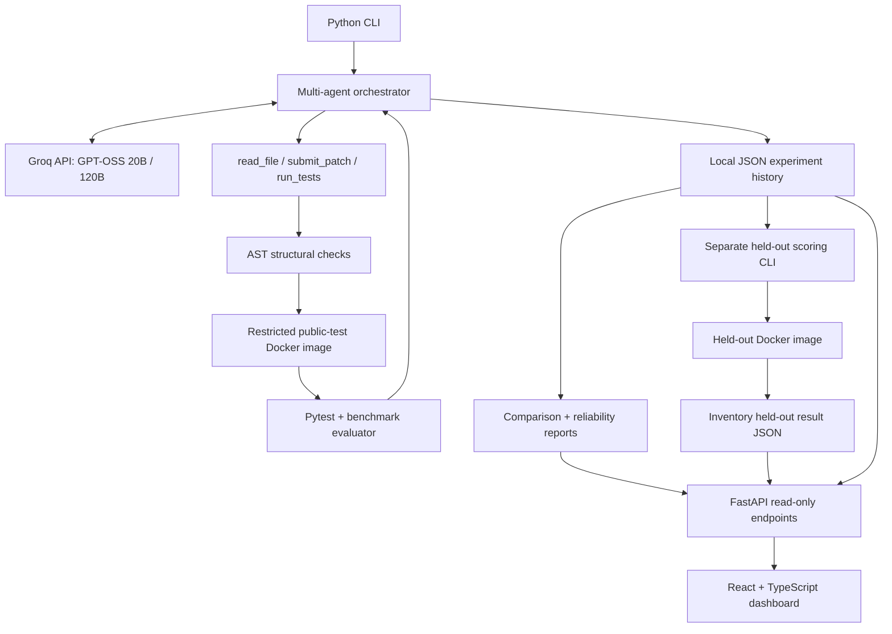

# AgentForge

[](https://github.com/jonathanprogram2/agentforge/actions/workflows/ci.yml)

**A local AI coding-agent evaluation platform** for testing iterative Python bug fixes, comparing model behavior, and exploring agent execution traces through a React dashboard.

AgentForge gives an LLM three tools—`read_file`, `submit_patch`, and `run_tests`—to investigate a deliberately buggy Python function, propose a replacement, and evaluate it against Pytest cases in a restricted Docker container. Each run records test outcomes, tool activity, token usage, and elapsed time for later analysis.

> **Project scope:** A portfolio and research prototype using four small, synthetic coding challenges. This is **not** SWE-bench, a production-grade security sandbox, or a statistically validated leaderboard.

## What it does

- **Iterative tool-calling agents:** inspect allowed source/tests, propose a patch, run tests, and refine a failed attempt.
- **Two supported models:** `openai/gpt-oss-20b` and `openai/gpt-oss-120b`, accessed through Groq's OpenAI-compatible API.
- **Four benchmark tasks:** pricing discounts, pagination, inventory reconciliation, and workflow dependency resolution.
- **Docker-based test execution:** run submitted code with network access disabled, read-only root filesystem, non-root UID, and resource limits.
- **Experiment tracking:** save timestamped JSON reports and candidate patches locally in `reports/`.
- **Model comparisons and reliability summaries:** compare the newest runs and summarize repeated trials, including token and duration statistics.
- **Additional held-out evaluation:** separately score saved **inventory** patches on four tests not made available through the agent's `read_file` tool.
- **React dashboard:** display benchmarks, comparison charts, reliability cards, held-out results, and tool-call trajectories.
- **Continuous integration:** GitHub Actions runs Python tests, React lint/build checks, and a Docker image build with a held-out-files exclusion check.

## Architecture



For module responsibilities, scoring details, and security limitations, see [Architecture & Methodology](docs/ARCHITECTURE.md).

## Benchmarks

| Benchmark         | Function              | Fail-to-pass tests | Pass-to-pass tests |
| ----------------- | --------------------- | -----------------: | -----------------: |
| `pricing_case`    | `discounted_price`    |                  2 |                  2 |
| `pagination_case` | `paginate`            |                  2 |                  2 |
| `inventory_case`  | `reconcile_inventory` |                  2 |                  3 |
| `workflow_case`   | `resolve_workflow`    |                  2 |                  4 |

**Fail-to-pass** cases exercise behavior broken in the original implementation. **Pass-to-pass** cases check that already-correct behavior is preserved. The intentionally buggy benchmark baselines are expected to fail some tests; don't interpret those failures as problems with the platform's own CI tests.

## Quick start (Windows PowerShell)

**Prerequisites:** Python 3.10, Node.js 24 (as used in CI), Docker Desktop with Linux containers, and a Groq API key for running an LLM. Docker must be running before agent evaluation.

1. **Clone and install Python dependencies:**

   ```powershell
   git clone https://github.com/jonathanprogram2/agentforge.git
   cd agentforge
   py -3.10 -m venv .venv
   .\.venv\Scripts\python.exe -m pip install -r requirements.txt
   ```

2. **Configure your key** (only required when asking the model to solve a benchmark):

   ```powershell
   Copy-Item .env.example .env
   ```

   Edit `.env` and enter your `GROQ_API_KEY`. Never commit a real key.

3. **Build the two evaluation images:**

   ```powershell
   docker build -f Dockerfile.agent -t agentforge-sandbox:public-v5 .
   docker build -f Dockerfile.sandbox -t agentforge-sandbox:v4 .
   ```

4. **Run a coding agent** (uses Groq API tokens):

   ```powershell
   .\.venv\Scripts\python.exe -m app.multi_agent --benchmark workflow_case --model openai/gpt-oss-20b
   ```

   Try `--model openai/gpt-oss-120b` for the larger model. Use `--repeat 2` for two independent runs. Requests are subject to your Groq account's rate limits.

5. **Generate a comparison report** from the saved runs:

   ```powershell
   .\.venv\Scripts\python.exe -m app.compare
   ```

   This creates `reports/model_comparison_latest.json`. The report includes **only combinations for which experiment history exists**; to populate all eight rows, run both models on all four tasks.

6. **Start the API**, in one terminal:

   ```powershell
   .\.venv\Scripts\python.exe -m uvicorn app.main:app --reload
   ```

7. **Start the dashboard**, in a second terminal:

   ```powershell
   cd frontend
   npm ci
   npm run dev
   ```

   Open **http://localhost:5173**. API docs are available at **http://127.0.0.1:8000/docs**.

**Important for a fresh clone:** `reports/` is intentionally excluded from Git. The comparison API returns 404 until you generate a comparison report, and the dashboard currently displays an error until that report exists. Reliability and held-out sections remain empty until their respective reports are produced. The frontend is a **local dashboard**, not a deployed hosted demo.

### macOS / Linux notes

Use `python3.10 -m venv .venv`, then `.venv/bin/python` in place of `.\.venv\Scripts\python.exe`. Run the same Docker and npm commands. Your Docker daemon must support Linux containers.

## Evaluation commands

```powershell
# Run the platform's own tests (does not call Groq or require Docker)
.\.venv\Scripts\python.exe -m pytest tests -v

# Inspect the intentionally buggy baseline for a benchmark
.\.venv\Scripts\python.exe -m app.evaluator --benchmark workflow_case

# Summarize up to the two most recent saved inventory trials per model
.\.venv\Scripts\python.exe -m app.reliability --benchmark inventory_case --recent 2

# Score a saved INVENTORY candidate on the additional held-out test suite
.\.venv\Scripts\python.exe -m app.score_heldout --run-id YOUR_INVENTORY_RUN_ID
```

The final command needs a saved inventory run ID, found in `reports/history/`. The additional held-out suite currently exists **only for `inventory_case`**.

## API endpoints

| Method | Route                       | Purpose                                 |
| ------ | --------------------------- | --------------------------------------- |
| GET    | `/health`                   | Basic health check                      |
| GET    | `/api/benchmarks`           | Registered tasks and test counts        |
| GET    | `/api/experiments?limit=20` | Recent local experiment history         |
| GET    | `/api/comparison`           | Latest generated model comparison JSON  |
| GET    | `/api/reliability`          | Saved reliability summaries             |
| GET    | `/api/heldout`              | Recorded inventory held-out evaluations |

The backend serves **recorded results**; the React UI does not trigger arbitrary code execution or call Groq directly.

## Testing and CI

```powershell
.\.venv\Scripts\python.exe -m pytest tests -v
cd frontend
npm run lint
npm run build
```

The [GitHub Actions workflow](.github/workflows/ci.yml) checks the Python platform tests, frontend lint/build, and Docker build on pushes and pull requests. It also checks that the public agent image excludes the `heldout/` folder. CI **does not call Groq** and does not run the agent against live models.

## Security and interpretation limits

- **Not a secure Python sandbox.** AST-based filtering is only defense-in-depth; Python can express unsafe behavior in many ways. Docker container controls reduce exposure but do not guarantee safety against hostile code. Run this prototype locally on a trusted machine, not as an unrestricted public code-execution service.
- **Held-out does not mean secret.** The inventory tests are excluded from the agent's file-reading tool and public evaluation image, but they are committed to this repository and included in the separate scoring image.
- **Small synthetic tasks.** Passing four benchmarks, or getting 100% in a few trials, is not evidence of broad coding-agent reliability. The reliability view reports observed values for the latest N runs, not confidence intervals or controlled statistical comparisons.
- **Local results.** Generated reports and candidate patches are ignored by Git; another developer must run experiments to recreate the dashboard data. Network/API latency and model responses can vary.
- **No deployed frontend.** Use the local Vite + FastAPI setup above. Do not enter production credentials or submit untrusted user code.

## Project structure

```text
agentforge/
├── app/                 # Agent, FastAPI, evaluation, scoring, reporting
├── benchmarks/          # Four deliberately buggy Python benchmark cases
├── heldout/             # Additional inventory test cases
├── frontend/            # React + TypeScript + Vite dashboard
├── tests/               # Platform unit and API tests
├── docs/                # Architecture notes and demo walkthrough
├── .github/workflows/   # CI pipeline
├── Dockerfile.agent     # Public-test evaluation image
├── Dockerfile.sandbox   # Image for additional held-out scoring
├── requirements.txt
└── reports/             # Locally generated; Git-ignored
```

## Demo

See [Demo Walkthrough](docs/DEMO.md) for a concise recording plan and reproducible commands. Add real dashboard screenshots and a demo-video link to this README once you've recorded them.

---

**Built as a hands-on AI agent engineering and evaluation portfolio project.** The goal is to make execution, scoring, and failure modes inspectable—not to overstate results from a small benchmark suite.
