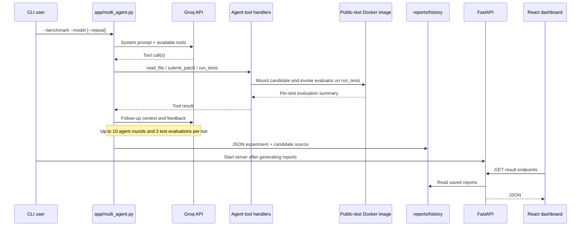
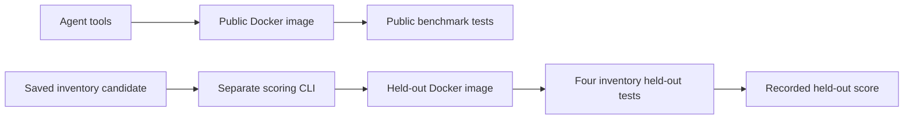

# AgentForge — Architecture & Evaluation Methodology

This document describes the **currently implemented** AgentForge prototype. It is not a proposal for cloud infrastructure, a hosted product, or a hardened execution service.

## System overview

## Key modules

| Path | Current responsibility |
|---|---|
| `app/multi_agent.py` | Tool-calling loop, Groq access, rate-limit retries, experiment history, token/duration accounting |
| `app/sandbox.py` | Validates basic source structure and launches restricted Docker test runs |
| `app/evaluator.py` | Benchmark registry, Pytest execution, JUnit XML parsing, exact test collection and scoring |
| `app/compare.py` | Selects the newest completed experiment for each model + benchmark, writes comparison JSON |
| `app/reliability.py` | Summarizes the newest N trials per model for one benchmark |
| `app/heldout_runner.py` | Runs four additional inventory tests within the separate scoring image |
| `app/score_heldout.py` | Locates a saved inventory candidate and invokes held-out scoring in Docker |
| `app/main.py` | Read-only result endpoints used by React |
| `frontend/src/` | Dashboard, graphs, experiment explorer, reliability and held-out cards |

## Agent tool contract

- **`read_file(filename)`** reads only the selected benchmark's source file, `test_bug.py`, or `test_regression.py`. The LLM is explicitly allowed to inspect **public benchmark tests**.
- **`submit_patch(code)`** accepts a full replacement for one expected function, subject to source-length and AST checks. This is **not** secure validation of arbitrary Python.
- **`run_tests()`** runs the submitted patch against the benchmark tests in a Docker container. The tool feeds result details back to the agent so it can iterate.

The agent uses the OpenAI Python SDK configured with Groq's compatible API endpoint. Supported model IDs are `openai/gpt-oss-20b` and `openai/gpt-oss-120b`. Live LLM calls require a Groq key; other reporting and platform tests operate without an LLM call.

## Benchmark methodology

1. Each synthetic task begins with a **deliberately buggy** Python implementation.
2. Each task declares **fail-to-pass** cases: tests that should initially fail and pass after the repair.
3. It also declares **pass-to-pass** cases: regression checks expected to remain green.
4. The Pytest evaluator captures JUnit XML. Registered test names must match the collected cases exactly; duplicate and missing names are errors.
5. Test failures, errors, and skips all count as nonpassing outcomes. A successful run must pass both groups with no nonpassing outcomes.
6. One agent experiment is capped at 10 model interaction rounds and 3 Docker evaluations; a model can repair and retry within those limits.

**Available benchmark tasks**

| Task | Broken behavior | Total public tests |
|---|---|---:|
| Pricing | Discount arithmetic | 4 |
| Pagination | Next-page boundary handling | 4 |
| Inventory | Sequential stock updates | 5 |
| Workflow | Shared dependencies incorrectly treated as cycles | 6 |

These benchmarks are examples designed for quick repeatable experimentation. They are **not** a representative sampling of real-world software defects and are not comparable to established large-scale coding benchmarks.

## Reporting and what metrics mean

A run can record `run_id`, `benchmark`, `model`, `success`, `evaluations_used`, `tokens_used`, `duration_seconds`, `evaluation`, `final_message`, and `trajectory`. Tool logs avoid repeating source contents, but saved candidate patch files are written to `reports/history/`.

- **Success:** every registered benchmark test passed for that run.
- **Token usage:** usage reported by the Groq-compatible model endpoint and accumulated across responses; API/provider accounting may vary.
- **Duration:** wall-clock duration measured for an agent run, including model response latency, retries, and Docker work.
- **Tool errors:** count of recorded tool events whose result contains an error.
- **Comparison report:** latest saved completed evaluation per model-task pairing; not a matched or randomized benchmark experiment.
- **Reliability report:** observed success fraction, token mean, latency mean and sample standard deviation for up to N most recent trials. Small samples have high uncertainty.

The `reports/` folder is Git-ignored, so model results displayed locally are **not shipped with a fresh checkout**. The dashboard's comparison panel requires `reports/model_comparison_latest.json` to exist.

## Held-out evaluation: precise trust boundary

The agent's `read_file` tool and public-test image do not expose `heldout/`. However:

- Those tests are **present in the source repository** and in the **separate scoring image**.
- The current system does **not** provide an adversary-resistant secret grading service.
- Additional held-out scoring currently applies to **inventory only**, not to the other three tasks.
- A separately saved local experiment can be scored after the agent finishes. These extra tests check behavior beyond the public cases but do not establish general reliability.

## Local execution safeguards

The benchmark Docker invocation uses `--network none`, `--read-only`, non-root UID `10001`, `--cap-drop ALL`, `--security-opt no-new-privileges`, CPU and memory limits, a PID limit, and restricted temporary write areas. Candidate source is mounted read-only as the target benchmark function file.

The AST validator additionally restricts obvious undesired patterns. **It is neither a complete security boundary nor proof that arbitrary Python is safe to run.** Malicious code could exploit language features or container/runtime vulnerabilities; Docker can also expose a risk to the host. Use trusted local synthetic tasks only; do not provide a public arbitrary code-execution endpoint or process adversarial submissions.

## API and frontend boundaries

`app/main.py` exposes read-only GET endpoints for metadata and **previously saved reports**. The React dashboard does not itself invoke Groq or submit code for evaluation. CORS currently allows development origins on localhost port 5173; the frontend uses the local backend URL `http://127.0.0.1:8000`.

## Reproducing and interpreting results

- **Platform verification:** `python -m pytest tests -v` checks your own code, not the deliberately buggy task baselines.
- **Build verification:** GitHub Actions verifies the frontend build and the public Docker image; it does not guarantee production security or model correctness.
- **Model replication:** results can change with model serving behavior, time, latency, Groq limits, and prompt context. Record exact run IDs and candidate source when presenting a comparison.
- **Data hygiene:** don't commit Groq keys, raw private input, or unreviewed model-generated source. `.env` and `reports/` are excluded from version control.

## Possible V2 improvements

Truly secret evaluation infrastructure, robust code isolation (e.g., dedicated microVMs), a larger and independently curated benchmark collection, statistically meaningful repeated evaluations, automatic dataset/version stamping, richer CI tests of the full end-to-end pipeline, and a read-only hosted demo based on explicitly labeled published data.
